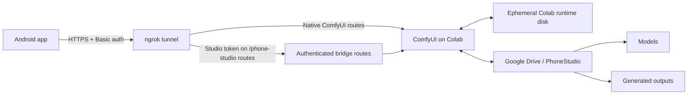

# Phone Studio

Phone Studio is a private, phone-first interface for running ComfyUI on a Google Colab GPU. The Android app is a lightweight remote control: it builds and submits a text-to-image workflow, follows the render in the background, and displays the finished image. Model weights, generated images, and the ComfyUI workspace remain in Google Drive rather than being downloaded to the phone.

The project has two cooperating parts:

- `PHONE_STUDIO_COLAB.ipynb` prepares ComfyUI, persistent Drive storage, the authenticated Phone Studio bridge, GPU optimizations, and an ngrok tunnel.
- `app/` contains the native Android client, written in Kotlin with Jetpack Compose.

Phone Studio does **not** run Stable Diffusion locally, start a Colab GPU automatically, or provide a hosted multi-user service. A Colab GPU runtime must be started manually and kept running while the app is in use.

## Contents

- [Features](#features)
- [How it works](#how-it-works)
- [Requirements](#requirements)
- [Quick start](#quick-start)
- [Colab backend](#colab-backend)
- [Using the Android app](#using-the-android-app)
- [Generation workflow](#generation-workflow)
- [Background rendering and recovery](#background-rendering-and-recovery)
- [Storage and persistence](#storage-and-persistence)
- [Security](#security)
- [Performance settings](#performance-settings)
- [Build and development](#build-and-development)
- [Project structure](#project-structure)
- [Troubleshooting](#troubleshooting)
- [Known limitations](#known-limitations)
- [Secondary notebook](#secondary-notebook)
- [License](#license)

## Features

- Native Android 8.0+ client with a portrait-oriented Jetpack Compose interface.
- Prompt and negative-prompt editing.
- Checkpoint discovery from the Drive-backed ComfyUI model folders.
- Optional LoRA selection and strength control.
- Tall (`768 × 1024`), square (`1024 × 1024`), and wide (`1024 × 768`) presets.
- Fast 18-step and balanced 28-step render presets, plus manual step and CFG controls.
- Fixed or automatically generated seeds.
- Direct Civitai model-version downloads from Colab into Google Drive.
- Foreground-service rendering that can continue while the app is backgrounded or removed from Recents.
- Durable request IDs and prompt-ID recovery to avoid duplicate submissions after a network interruption.
- Optional completion notifications.
- Session image library with prompt, model, dimensions, and seed metadata.
- Persistent models and outputs in Google Drive.
- Password-protected HTTPS tunnel plus a separate token for Phone Studio's custom API.
- Startup and per-runtime warm-up jobs to reduce the delay before the first visible image.
- Ephemeral local model caching on the Colab VM to avoid repeatedly loading large weights directly from Drive.

## How it works



1. The Colab notebook mounts Google Drive and creates the persistent Phone Studio folders.
2. It clones or updates ComfyUI on Colab's faster, temporary `/content` disk.
3. It links ComfyUI's model, input, output, user, and custom-node directories to Drive.
4. It writes a small custom bridge that lists models, manages Civitai downloads, and helps recover interrupted client requests.
5. It starts ComfyUI on `127.0.0.1:8188`, warms the configured checkpoint, and exposes the server through an authenticated ngrok HTTPS endpoint.
6. The Android app submits an ordinary ComfyUI API workflow to `/prompt`, polls `/history/{promptId}`, and loads completed images from `/view`.
7. ComfyUI writes the durable image files to `MyDrive/PhoneStudio/output`; the phone only displays them over the tunnel.

## Requirements

### To run Phone Studio

- An Android device or emulator running Android 8.0 / API 26 or newer.
- A Google account with access to Google Drive and Google Colab.
- A Colab runtime with a supported NVIDIA GPU. A T4 is the intended baseline.
- An [ngrok](https://ngrok.com/) account and authtoken.
- A compatible checkpoint already stored in Google Drive. The notebook currently expects `waiIllustriousSDXL_v170.safetensors` by default and does not download it automatically.
- Internet access from both the phone and the Colab runtime.

### To build the Android app

- JDK 17.
- Android SDK Platform 35 and standard Android build tools, most easily installed through Android Studio.
- Internet access for the first Gradle dependency download.

The repository pins Gradle 8.10.2 through the wrapper, Android Gradle Plugin 8.7.3, and Kotlin 1.9.25.

## Quick start

### 1. Put the checkpoint in Google Drive

Create this location and upload the expected checkpoint:

```text
MyDrive/
└── PhoneStudio/
    └── models/
        └── checkpoints/
            └── waiIllustriousSDXL_v170.safetensors
```

If the checkpoint has a different filename or is inside a subfolder, edit `DEFAULT_CHECKPOINT` in the GPU settings cell of `PHONE_STUDIO_COLAB.ipynb`. Set it to the path relative to `models/checkpoints`, for example `illustration/model.safetensors`. Setting it to an empty string enables the notebook's WAI Illustrious v170 filename matching.

This initial checkpoint is a startup prerequisite. The in-app downloader is not available until the backend has already started successfully.

### 2. Configure Colab Secrets

Open Colab's **Secrets** panel and add the following values:

| Secret | Required | Purpose |
| --- | --- | --- |
| `NGROK_AUTHTOKEN` | Yes | Allows the notebook to create the private tunnel used by the phone. |
| `NGROK_DOMAIN` | Recommended | Keeps the public server URL stable across tunnel reconnects. Use an ngrok dev domain assigned to your account. |
| `CIVITAI_API_KEY` | Optional | Authenticates model-version lookups and downloads initiated from the app. |
| `PHONE_STUDIO_TOKEN` | Optional | Overrides the generated token used for the custom bridge routes. |
| `TUNNEL_PASSWORD` | Optional | Overrides the generated HTTP Basic-auth password. |
| `PHONE_STUDIO_AUTO_COMPILE` | Optional | Set to `1` to opt into `torch.compile` on supported GPUs; it is forced off on T4/pre-Ampere hardware. |

Do not place secrets directly in the notebook. When token/password overrides are omitted, the notebook generates them and persists them in `MyDrive/PhoneStudio/.phone_studio_credentials.json` so the values remain stable between sessions.

### 3. Start the Colab backend

1. Upload or open `PHONE_STUDIO_COLAB.ipynb` in Google Colab.
2. Select **Runtime → Change runtime type** and choose a GPU runtime.
3. Run every cell from top to bottom.
4. Wait for the startup warm-up to finish.
5. Leave the final cell running. It intentionally remains busy and prints:

   ```text
   Server URL
   Tunnel user
   Tunnel password
   Studio token
   ```

The tunnel username defaults to `studio`. Interrupting the final cell shuts down ComfyUI and disconnects the tunnel.

### 4. Build and install the Android app

On Windows:

```powershell
.\gradlew.bat assembleDebug
```

On macOS or Linux:

```bash
./gradlew assembleDebug
```

The APK is written to:

```text
app/build/outputs/apk/debug/app-debug.apk
```

Install it through Android Studio, copy the APK to the device, or use a connected device:

```powershell
.\gradlew.bat installDebug
```

### 5. Connect the app

1. Open **Connect** in Phone Studio.
2. Optionally save the Colab notebook URL so the app can open it later.
3. Paste the four values printed by the notebook's final cell.
4. Select **Save & Test Connection**.
5. When the status changes to **Colab Online**, open **Create**, choose a checkpoint, enter a prompt, and generate an image.

On Android 13 and newer, allow notifications if you want progress and completion alerts. The app can still render when completion alerts are disabled, but Android may limit how foreground-service notifications are presented when permission is denied.

## Colab backend

`PHONE_STUDIO_COLAB.ipynb` is the backend intended for the Android app. Each fresh Colab runtime performs the following work:

1. Mounts Google Drive.
2. Creates the persistent folder layout under `MyDrive/PhoneStudio`.
3. Creates or loads the private tunnel password and Studio token.
4. Installs system packages required by ComfyUI.
5. Clones ComfyUI into `/content/ComfyUI`, or fast-forwards an existing runtime checkout.
6. Installs ComfyUI's Python requirements plus `pyngrok` and `requests`.
7. Links persistent folders from Drive into the runtime checkout.
8. Detects the GPU and chooses an attention backend.
9. Writes the Phone Studio bridge into the Drive-backed custom-node folder.
10. Starts ComfyUI locally, runs a warm-up workflow, and opens the ngrok tunnel.
11. Keeps the final cell alive, checks the ComfyUI process, and reconnects a dropped tunnel.

### Bridge endpoints

The notebook adds the following authenticated routes to ComfyUI:

| Method | Path | Purpose |
| --- | --- | --- |
| `GET` | `/phone-studio/health` | Confirms that the bridge is ready and returns a runtime instance ID. |
| `GET` | `/phone-studio/models` | Lists checkpoints and LoRAs visible in the Drive-backed model folders. |
| `POST` | `/phone-studio/download-model` | Starts an asynchronous Civitai model-version download. |
| `GET` | `/phone-studio/downloads/{jobId}` | Reports download status, progress, filename, and errors. |
| `GET` | `/phone-studio/latest-job` | Recovers the latest matching prompt ID for a stable phone client/request pair. |

The app also uses ComfyUI's standard `/prompt`, `/history/{promptId}`, and `/view` endpoints. The ngrok Basic-auth layer protects the entire tunnel; the `X-Phone-Studio-Token` header is additionally required by the custom `/phone-studio/*` routes.

### Model management

Checkpoints and LoRAs can be supplied in either of two ways:

- Copy files directly to `MyDrive/PhoneStudio/models/checkpoints` or `MyDrive/PhoneStudio/models/loras`, then select **Refresh** in the Models screen.
- Paste a numeric Civitai model-version ID, or a URL containing `modelVersionId=...`, into the Models screen. Choose **Checkpoint** or **LoRA** before starting the download.

The server chooses the primary SafeTensors file returned by Civitai, sanitizes its filename, downloads to a temporary `.part` file, and only moves it into the model folder after completion. Downloads go directly to Drive, not to the phone.

Use a **model-version** URL or ID, not only a general Civitai model page. Models can be very large, so ensure both Drive space and Colab runtime time remain available. You are responsible for each model's license and permitted use.

## Using the Android app

The bottom navigation exposes four screens:

| Screen | What it does |
| --- | --- |
| **Create** | Edits the prompt, negative prompt, checkpoint, canvas format, render pace, CFG, seed, and optional LoRA before starting a render. |
| **Library** | Shows up to 40 images known to the current app session, with a full-screen detail view. Durable originals remain in Drive. |
| **Models** | Lists checkpoints and LoRAs, changes the active model, refreshes the catalog, and starts Civitai downloads. |
| **Connect** | Saves the notebook URL and server credentials, opens Colab, tests the bridge, or forgets the current connection. |

Connection details are saved on the device so the app can reconnect on launch. **Forget Connection on This Phone** stops the active service, clears the current job, and removes Phone Studio's saved app preferences from that device.

## Generation workflow

The Android client constructs a compact ComfyUI workflow for every render:

```text
CheckpointLoaderSimple
        │
        ├── optional LoraLoader
        │          ├── CLIPTextEncode (positive)
        │          └── CLIPTextEncode (negative)
        │
EmptyLatentImage ── KSampler ── VAEDecode ── SaveImage
```

Current defaults and controls:

| Setting | Default | Available in the app |
| --- | --- | --- |
| Positive prompt | Empty | Free text, required before generation. |
| Negative prompt | `low quality, blurry, watermark, text` | Free text. |
| Dimensions | `768 × 1024` | Tall, square, or wide presets. |
| Steps | `28` | Fast 18, balanced 28, or advanced range 12–50. |
| CFG | `6.5` | Advanced range 1.0–12.0. |
| Seed | Random | Blank generates a positive random seed; a numeric value makes runs repeatable. |
| Sampler | `euler_ancestral` | Fixed by the current workflow. |
| Scheduler | `normal` | Fixed by the current workflow. |
| Batch size | `1` | Fixed by the current workflow. |
| LoRA strength | `0.8` | Optional range 0.0–1.5, applied to model and CLIP. |

The resolved seed is persisted before submission so recovery follows the same job. Completed files use the `PhoneStudio` filename prefix in ComfyUI's output folder.

## Background rendering and recovery

Generation is owned by an Android foreground service rather than the Compose screen. This allows a render to continue when the activity is backgrounded, the phone is locked, or the app is swiped out of Recents.

The service persists the complete job description, a stable client ID, a unique request ID, and the returned ComfyUI prompt ID. If the submission response is lost during a network change, the app asks `/phone-studio/latest-job` whether Colab already accepted the same request before it considers another submission. While a prompt is running, `/history/{promptId}` is polled once per second. Temporary network and selected server failures use an increasing retry delay of up to eight seconds.

A generation is considered timed out after ten minutes. This stops the phone from polling; it does not guarantee that ComfyUI cancelled the server-side job. Check the Colab output and ComfyUI history if a long render exceeds that limit.

Important Android behavior:

- Only one Phone Studio render is allowed at a time.
- The ongoing foreground notification is required by Android while the service is active.
- **Notify when ready** controls the separate completion notification.
- Android **Force stop**, stopping the app from the Active Apps interface, revoking required system behavior, or rebooting can stop the service. Opening the app again attempts to resume a persisted active job when possible.
- There is currently no in-app cancel button; forgetting the connection stops and clears the active Phone Studio job state.

## Storage and persistence

### Google Drive

The notebook creates and reuses this layout:

```text
MyDrive/PhoneStudio/
├── .phone_studio_credentials.json
├── custom_nodes/
│   └── phone_studio_bridge/
├── input/
├── models/
│   ├── checkpoints/
│   ├── controlnet/
│   ├── loras/
│   ├── upscale_models/
│   └── vae/
├── output/
└── user/
```

- Models, custom nodes, user data, inputs, and outputs survive Colab runtime resets.
- `.phone_studio_credentials.json` contains the generated Studio token and tunnel password. Protect access to the Drive folder.
- Generated images are durable in `output/`, even when they no longer appear in the phone's session library.

### Colab runtime disk

- `/content/ComfyUI` contains the temporary runtime checkout and is lost when Colab recycles the VM.
- `/content/phone_studio_model_cache` contains hashed local copies of model files used during the current runtime. It is also temporary.
- The cache defaults to a 24 GiB maximum while reserving at least 8 GiB of free runtime disk. If those limits cannot be met, the original Drive file is used.

### Android device

The app stores connection settings, the optional Colab URL, a stable client ID, warm-up state, and the notification preference in app-private `SharedPreferences`. The active generation record is stored separately so the service can recover after process recreation. These preferences are private to the Android application sandbox but are not encrypted by the application, and the manifest currently allows Android backup.

The visual library is intentionally not a replacement for Drive-based output storage. It keeps at most 40 items in the current UI state; the latest persisted completion may be restored after process recreation, while older session entries are not a durable catalog. Displaying an older library item also requires a reachable ComfyUI tunnel because the app retains a remote `/view` URL rather than an on-device image copy.

## Security

Phone Studio is designed for a single person's private workflow, not as a public ComfyUI deployment.

- Always use the HTTPS ngrok URL printed by the notebook. The Android manifest rejects cleartext HTTP traffic.
- ngrok HTTP Basic authentication protects access to the whole ComfyUI tunnel.
- The separate Studio token protects model-management, health, and recovery routes.
- Treat the server URL, tunnel username, tunnel password, and Studio token as secrets.
- Do not post notebook output, screenshots containing credentials, `.phone_studio_credentials.json`, or configured app backups.
- The Android client currently stores credentials in ordinary app-private preferences rather than encrypted storage.
- The notebook's final cell exposes the full ComfyUI HTTP API through the authenticated tunnel. Use a strong password and never remove authentication when the endpoint is internet-accessible.
- Rotate `TUNNEL_PASSWORD` and `PHONE_STUDIO_TOKEN` if the values may have been disclosed. Supplying new Colab Secrets and rerunning the setup cell updates the persisted values.
- Civitai tokens remain in Colab and are not sent to the Android client.

## Performance settings

The primary notebook is tuned for Colab while preserving the workflow's requested prompt, dimensions, sampling steps, and LoRA strength.

### Defaults

- FP16 UNet and text encoding.
- cuDNN autotuning through ComfyUI's fast autotune mode.
- `CHANNELS_LAST = True`, intended for the current WAI Illustrious / SDXL checkpoint.
- `VRAM_MODE = 'auto'`, leaving ComfyUI's dynamic memory behavior enabled.
- Local runtime model cache enabled with a 24 GiB cap and 8 GiB reserve.
- PyTorch cross-attention on T4/pre-Ampere GPUs.
- An attempted SageAttention2 installation on GPUs with compute capability 8.0 or newer, with automatic fallback if installation fails.
- Automatic `torch.compile` disabled unless explicitly enabled and supported.
- TensorRT installation disabled because the normal workflow uses `CheckpointLoaderSimple`, not a TensorRT loader.

### Warm-up behavior

There are two distinct warm-up paths:

1. The notebook runs a `1024 × 1024`, two-step, no-LoRA preview through checkpoint loading, text encoding, sampling, and VAE decoding before it prints the connection details.
2. After a successful app connection, the Android client can submit a tiny `128 × 128`, one-step preview once per Colab runtime instance and selected model. It is not saved to the gallery.

Warm-ups and the first model copy make startup slower but reduce work deferred to the first visible render. Changing checkpoints, adding a LoRA, memory pressure, or a recycled Colab runtime can introduce the loading cost again.

### Adjusting the notebook

The GPU settings cell exposes:

- `LOCAL_MODEL_CACHE`
- `MODEL_CACHE_MAX_GB`
- `MODEL_CACHE_RESERVE_GB`
- `VRAM_MODE`
- `CHANNELS_LAST`
- `DEFAULT_CHECKPOINT`
- `WARMUP_ON_START`
- `WARMUP_WIDTH`, `WARMUP_HEIGHT`, `WARMUP_STEPS`, and `WARMUP_TIMEOUT_SECONDS`
- `INSTALL_TENSORRT` in the following optional cell

Use `VRAM_MODE = 'high'` only when the complete workflow fits in GPU memory. Disable channels-last when testing an unfamiliar architecture that does not tolerate this layout. Enabling compilation can make the first sample substantially slower and is not supported by the notebook's T4 path.

## Build and development

### Android configuration

| Property | Value |
| --- | --- |
| Application ID | `app.phonestudio` |
| Version | `0.1.0` (`versionCode` 1) |
| Minimum SDK | 26 |
| Target / compile SDK | 35 |
| Java / JVM target | 17 |
| UI | Jetpack Compose + Material 3 |
| Networking | OkHttp 4.12.0 |
| JSON | kotlinx.serialization 1.6.3 |
| Image loading | Coil 2.7.0 |

### Common Gradle tasks

Use `gradlew.bat` on Windows and `./gradlew` on macOS/Linux.

```powershell
# Compile a debug APK
.\gradlew.bat assembleDebug

# Install the debug build on a connected device/emulator
.\gradlew.bat installDebug

# Run Android lint
.\gradlew.bat lintDebug

# Run local unit-test tasks
.\gradlew.bat testDebugUnitTest

# Run instrumented tests on a connected device/emulator
.\gradlew.bat connectedDebugAndroidTest
```

There are currently no repository-authored unit or instrumented test source sets, so the standard test tasks do not provide meaningful project coverage yet.

The release build type is not minified and has no signing configuration in the repository. A production release requires a private signing configuration and the usual Android release review. Never commit a keystore or signing passwords.

## Project structure

```text
.
├── app/
│   ├── build.gradle.kts
│   ├── proguard-rules.pro
│   └── src/main/
│       ├── AndroidManifest.xml
│       ├── java/app/phonestudio/
│       │   ├── GenerationService.kt
│       │   ├── MainActivity.kt
│       │   ├── StudioViewModel.kt
│       │   ├── data/
│       │   │   ├── ComfyApi.kt
│       │   │   ├── GenerationStore.kt
│       │   │   ├── Models.kt
│       │   │   └── StudioPreferences.kt
│       │   └── ui/
│       │       ├── PhoneStudioApp.kt
│       │       └── Theme.kt
│       └── res/
├── gradle/wrapper/
├── PHONE_STUDIO_COLAB.ipynb
├── comfyuibestest_editable.ipynb
├── build.gradle.kts
├── settings.gradle.kts
└── gradle.properties
```

Key Android files:

- `MainActivity.kt` requests notification permission when necessary, creates the view model, and hosts the Compose UI.
- `PhoneStudioApp.kt` implements the Create, Library, Models, and Connect screens.
- `StudioViewModel.kt` owns UI state, connection checks, model refresh/download state, warm-up submission, and generation validation.
- `GenerationService.kt` owns foreground execution, submission recovery, polling, notifications, and terminal job state.
- `ComfyApi.kt` builds ComfyUI workflow JSON and performs authenticated API requests.
- `GenerationStore.kt` durably records the active job and resolved seed.
- `StudioPreferences.kt` stores connection and per-device preferences.
- `Models.kt` defines connection, generation, image, job, and UI state models.

## Troubleshooting

### The notebook says no CUDA GPU is available

Choose **Runtime → Change runtime type → GPU** in Colab, reconnect, and rerun the notebook. Phone Studio cannot reserve or start a Colab GPU through an API.

### The default checkpoint cannot be found

Confirm that this exact file exists:

```text
MyDrive/PhoneStudio/models/checkpoints/waiIllustriousSDXL_v170.safetensors
```

Otherwise, edit `DEFAULT_CHECKPOINT` to the exact relative filename before running the GPU settings cell. The default notebook intentionally does not download that checkpoint.

### The app cannot connect

- Confirm that the final notebook cell is still running.
- Use the `https://` URL printed by the current notebook session.
- Recheck all four connection fields, including capitalization and whitespace.
- If no `NGROK_DOMAIN` is configured, a reconnected tunnel may receive a new URL. Paste the new value into the app.
- Rerun **Save & Test Connection** after restarting Colab.
- Check the final cell for a ComfyUI crash, ngrok error, or failed warm-up.

### The URL changes after a tunnel drop

Add the ngrok dev domain assigned to your account as the `NGROK_DOMAIN` Colab Secret. Without it, the notebook can reconnect automatically, but the replacement random URL must be copied to the phone manually.

### No checkpoints or LoRAs appear

- Confirm files are in the correct `MyDrive/PhoneStudio/models/...` folder.
- Supported catalog extensions are `.safetensors`, `.ckpt`, and `.pt`.
- Select **Refresh** in Models after copying or downloading a file.
- Wait for a Civitai job to report **Complete**; partial `.part` files are not catalog entries.

### A Civitai download fails

- Use a numeric model-version ID or a URL containing `modelVersionId=` or `/model-versions/`.
- Add a valid `CIVITAI_API_KEY` to Colab Secrets for authenticated access.
- Confirm that the selected version exposes a downloadable SafeTensors file.
- Check available Google Drive space and the error shown in the Colab output.

### The first render is slow

Fresh runtimes must install dependencies, copy the model from Drive to local runtime storage, load it into memory, and warm the GPU. Compare later renders using the same model, LoRAs, dimensions, sampler, and step count. A Colab reset clears runtime caches but not Drive data.

### A render stops updating in the background

- Reopen the app; it attempts to resume the persisted prompt.
- Confirm that Android did not Force stop the application.
- Confirm that Colab and the ngrok tunnel are still running.
- If the app reports its ten-minute timeout, inspect ComfyUI history and Colab logs before submitting again.
- A lost response does not necessarily mean the server rejected the prompt; the request-ID recovery logic exists to prevent an accidental duplicate.

### Android build fails before compilation

Confirm that JDK 17 is active and Android SDK Platform 35 is installed. If the SDK is outside the standard location, configure it through Android Studio or an uncommitted `local.properties` file.

## Known limitations

- Colab sessions are temporary, can be reclaimed, and must be started manually.
- The backend depends on the latest ComfyUI checkout at notebook run time rather than a pinned ComfyUI revision.
- The primary notebook is currently configured around an existing WAI Illustrious SDXL v170 checkpoint.
- Only one generation can be active from the phone at a time.
- The Android workflow is text-to-image only and fixed to a small standard node graph.
- The sampler and scheduler are not selectable in the current UI.
- There is no in-app render queue, batch control, cancel action, download/export action, or share action.
- The app is portrait-only.
- The phone library is not a complete, persistent browser for all files in the Drive output directory.
- There is no user/account system, remote access management, or multi-user isolation.
- App credentials are not stored with Android encrypted-storage APIs.
- Automated project tests and continuous integration are not currently included.
- Release signing and store deployment are not configured.

## Secondary notebook

`comfyuibestest_editable.ipynb` is a separate, experimental/general ComfyUI Colab launcher. It uses `MyDrive/ComfyUI_colab`, installs a larger collection of custom nodes, and downloads a specific workflow and supporting models. It does **not** install the authenticated Phone Studio bridge and is not a drop-in replacement for `PHONE_STUDIO_COLAB.ipynb`.

The secondary notebook contains environment-specific tunnel configuration, including an embedded credential in its current form. Treat that credential as compromised, rotate/remove it before any use, and audit the notebook's download URLs and custom-node repositories. For the Android workflow, use `PHONE_STUDIO_COLAB.ipynb`.

## License

This repository does not currently include a license file. No permission to copy, modify, or redistribute the project is granted by the repository itself until a license is added.
