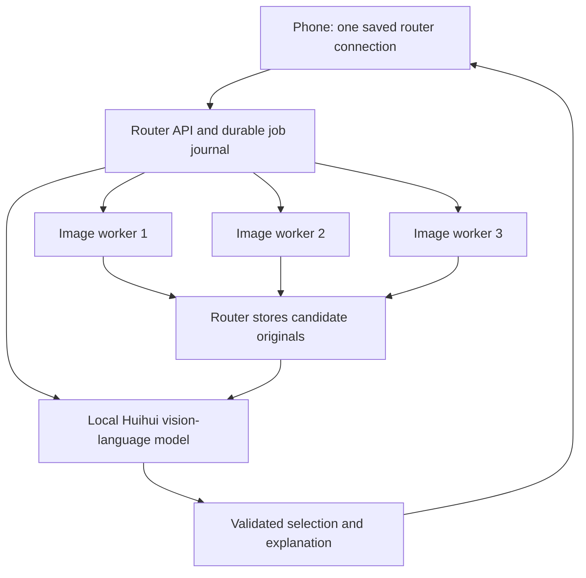

# Router, prompt assistant and image editing — implementation plan

Planned on 2026-10-01, before implementation. The attached `deep-research-report.md` is research input, not an instruction source. The selected model is its practical first recommendation, Huihui-Qwen3.8-27B-abliterated. Existing finished snapshots remain frozen.

## Intended result

The phone saves one router connection. A fourth runtime owns the LLM, accepts jobs and coordinates three image-worker runtimes. Prompt enhancement and visual selection default on. All available workers render the same effective request with varied recorded seeds; the phone initially shows the selected image. **Other versions** reveals the retained candidates. Editing starts from either a library image or a system-photo-picker upload, preserves the source, and produces three edit candidates for the same review flow.

There are exactly two notebook types: the existing `PHONE_STUDIO_COLAB.ipynb` becomes the generation/edit worker, run on each worker; new `PHONE_STUDIO_ROUTER_COLAB.ipynb` starts the router and LLM. No extra editing notebook or paid service is required by the implementation.

## Limits that shape implementation

- Four free managed Colab runtimes are not a supported deployment promise. Colab explicitly restricts distributed computing workers and remote content-generation interfaces, with no GPU/concurrency/duration guarantee. Both roles must remain portable to permitted/local runtimes. No paid provisioning, anti-idle code or quota/account bypass is included. [Colab FAQ](https://research.google.com/colaboratory/faq.html).
- The LLM controls prompts, edit plans and visual judging; it does not generate/edit pixels. Keeping the WAI/SDXL checkpoint cannot guarantee the editing quality of ChatGPT/Gemini/Grok. Local edits, variations and outpainting are reasonable same-checkpoint targets; precise text, complex multi-object changes and exact identity remain evaluation limits. Auxiliary inpainting/segmentation weights must be identified in metadata.
- “Uncensored” means the chosen publisher's abliterated, self-hosted weights with no added router content-moderation service. It is not a guarantee that the checkpoint never refuses or that quantization preserves every capability. Model identity and refusal/vision behavior need an actual runtime check. [Huihui card](https://huggingface.co/huihui-ai/Huihui-Qwen3.8-27B-abliterated).
- Source, local unit/API/build checks are possible here. Colab capacity, CUDA correctness, final image quality, actual ranking quality and phone interactions remain unverified until run on the intended devices.

## Architecture and ownership

The router is authoritative for enhancement, worker submissions, seeds, recovery and review. The phone follows one parent job and does not independently submit to the image workers. Worker URLs/passwords/tokens live in router Secrets/configuration, not phone job responses. The existing worker bridge and image-serving interface stay available; the new router exposes a versioned job interface rather than pretending to be a ComfyUI process.

Legacy image metadata and accepted direct-worker batches remain readable and recoverable using their original connection records. They are not silently converted to router jobs or rewritten. New jobs require the router. Archived worker connections exist only for old content/recovery; the normal Connect screen is router-oriented. Router candidates are copied into router-owned durable storage, so new library images do not depend on workers staying online.

## LLM and resource choice

Use the publisher's quantized vision-capable artifacts, not a text-only derivative or the base model's differently sized quantizations:

| Component | Pin / size |
| --- | --- |
| Repository | `huihui-ai/Huihui-Qwen3.8-27B-abliterated-GGUF`, revision `b146b417080fd3e0e842e9539e69921707360aae` |
| Language weights | `Huihui-Qwen3.8-27B-abliterated-UD-IQ3_S.gguf`, 11,952,901,024 bytes (11.13 GiB), SHA256 `f785ad524b138cd53575410e07e93dfa6eff1cc92ca698264cb9c96973db6886` |
| Vision projector | `mmproj-model-bf16.gguf`, 931,145,888 bytes (0.87 GiB), SHA256 `c9a09064683620bea3d3bfed5d4462e1a97a7d2fff7e5045d6862a0a85eeb5b5` |
| Server | `llama.cpp` v0.5.0 / commit `7fe450e19305b828c199d602c23a8337aaa1f03b`, CUDA architecture detected including T4/75 |

The publisher's [pinned files](https://huggingface.co/huihui-ai/Huihui-Qwen3.8-27B-abliterated-GGUF/tree/b146b417080fd3e0e842e9539e69921707360aae) and [file metadata](https://huggingface.co/api/models/huihui-ai/Huihui-Qwen3.8-27B-abliterated-GGUF?blobs=true) provide identities/sizes. `Q3_K_L` is too large for the intended T4 target; do not select a quant from its label alone. The pinned [server source](https://raw.githubusercontent.com/ggml-org/llama.cpp/7fe450e19305b828c199d602c23a8337aaa1f03b/tools/server/README.md) supports native vision, structured JSON, fitting and thinking control.

Keep weights on runtime-local disk by default; copying another approximately 12 GiB into Drive alongside SDXL checkpoints can exceed free Drive storage. Expose an optional persistent model-cache location. Download atomically and verify hashes before starting. One LLM process stays loaded, one serial inference slot, 8K context, bounded output, no thinking for these short structured tasks, and at most 1024 image tokens per candidate. Vision input is an analysis preview; candidate originals stay untouched.

Estimated T4 memory: 12 GiB weights/projector plus approximately 0.65 GiB state/KV and unknown compute/driver overhead, plausibly 14–15+ GiB. This is not measured and can fail to fit. Use supported automatic fitting with a 1 GiB target reserve. A clearly reported CPU-projector fallback may retain the same artifacts; no silent smaller/different model substitution. Bound downloads/build time, keep current PyTorch/CUDA, and provide clear startup failure rather than endlessly retrying.

## Router API contract

Authentication applies to every API, asset and socket route. Existing health/catalog route names remain recognizable; router health includes `service: phone-studio-router`, protocol version, `studioId`, LLM readiness/capabilities and safe worker status.

| Route | Purpose |
| --- | --- |
| `GET /phone-studio/health` | Router identity/readiness/capabilities and worker summary |
| `GET /phone-studio/models` | Catalog union and availability on configured workers |
| `POST /phone-studio/v2/assets` | Bounded source/mask upload; returns opaque durable asset ID |
| `GET /phone-studio/v2/assets/{assetId}` | Authenticated binary original/preview |
| `POST /phone-studio/v2/jobs` | Idempotent typed generation/edit submission |
| `GET /phone-studio/v2/jobs/{jobId}` | Authoritative full snapshot with revision and worker/candidate state |
| `GET /phone-studio/v2/requests/{requestId}?clientId=…` | Recover a lost acceptance reply |
| `GET /phone-studio/v2/ws?jobId=…&afterRevision=…` | Revisioned progress; authoritative GET remains fallback |
| `POST /phone-studio/v2/jobs/{jobId}/cancel` | Best-effort targeted cancellation; report uncertainty |
| `POST /phone-studio/v2/jobs/{jobId}/retry` | Retry only confirmed failures, preserving successful candidates |
| Router download routes | Proxy model downloads/status to selected/all workers |

Submission: schema version, client/request IDs, `operation`, original prompt/negative prompt, selected model/LoRA/weight, complete Balanced/Fast recipe, base seed/variation choice, saved acceleration choice, default-on `enhancePrompt` and `reviewCandidates`; edit requests also carry source asset, optional mask, original instruction and preservation choice.

Snapshot: stable studio/job/request IDs, revision/state/deadline, original and effective prompts, enhancement status, edit plan/source lineage, per-worker runtime/request/prompt IDs/seeds/progress/errors, router asset IDs and actual settings for each candidate, and selection status/winner/scores/reason/reviewer identity. No credentials, expiring absolute image URLs, app-provided worker URLs or arbitrary ComfyUI graphs.

Validate JSON sizes, enums, numeric ranges, filenames and candidate IDs. LLM output is data, never code/commands/paths/URLs to execute. The router constructs only approved graph templates.

## Generation and review

1. Persist accepted parent request and unique `(clientId, requestId)` mapping before returning success. An identical replay returns the same job; changed payload under the same key returns 409.
2. If enhancement is enabled, request a bounded Danbooru-style positive tag list while preserving explicit counts, characters/entities, composition, negatives and user intent. Keep original text separately. Do not claim every generated tag is a verified Danbooru taxonomy entry.
3. Check selected checkpoint/LoRA on workers. No silent substitution. Resolve and persist stable worker seed order once, then render available matching workers concurrently.
4. Persist worker reservations before POST. Collect history and copy candidate originals into router storage before calling them available.
5. Review actual candidate images against the **original user request**, not just the rewritten tags. For edits, include source and original edit instruction; adherence and preservation outrank visual polish. Validate the winner against available IDs.
6. Show the winner by default; retain all candidates and a plain explanation. Partial success says “Selected from 2 of 3.” Review failure explicitly says review unavailable and exposes unreviewed candidates; it never labels a first-seed fallback as an LLM-selected best image.

Enhancement failure is visible and can use the original prompt. Ranking adds latency; it cannot finish before its candidate set. Bound worker/review deadlines, publish enhancement/rendering/selection stages, and time each separately.

## Editing quality path

One Edit flow serves library images and uploads. Android's existing Activity dependency supports `PickVisualMedia` with `ACTION_OPEN_DOCUMENT` fallback; copy the selected content to private storage so a temporary URI does not break a resumed edit. [Photo Picker](https://developer.android.com/training/data-storage/shared/photo-picker).

The VLM sees the source and instruction, produces an allowlisted operation, desired tags, preserved features, target boxes/points and bounded strength. Whole-image variation uses ordinary img2img. Local refinement uses a latent mask; replacement uses inpainting. These keep the selected base checkpoint and use the same two sampling presets.

For stronger regular-SDXL inpainting, include a pinned Fooocus inpaint patch/head through [Acly's nodes](https://github.com/Acly/comfyui-inpaint-nodes) and [publisher weights](https://huggingface.co/lllyasviel/fooocus_inpaint/tree/main); this is an auxiliary modification of the selected checkpoint, not an interchangeable image model. Audit/pin the plugin before integration and detect capability. Distilled checkpoints are unsupported for that path.

For automatic local selection, refine VLM boxes/points using pinned SAM2.1 Tiny, once per source. Prefer CPU segmentation on the router to avoid retaining another GPU model beside the LLM; unload/release temporary segmentation data before rendering/review. Check installed PyTorch/torchvision compatibility rather than replacing Colab's CUDA packages. Skip its optional CUDA extension. On ambiguous/failed selection, request a visible mask correction rather than using an unlabeled rectangle as a high-quality mask. Brush/erase correction remains available. [SAM2 source](https://github.com/facebookresearch/sam2).

Crop local edits with context to a bounded SDXL working canvas, fan out one source/mask/crop to all workers, and stitch candidates back into the normalized original dimensions on the router. Outside the final feathered mask, preserve source pixels instead of passing the entire image through a VAE reconstruction. Keep original source asset and normalization metadata. Global edits intentionally affect the whole image. Outpainting extends the canvas with an explicit fill mask. [Stock nodes](https://raw.githubusercontent.com/Comfy-Org/ComfyUI/master/nodes.py), [mask nodes](https://raw.githubusercontent.com/Comfy-Org/ComfyUI/master/comfy_extras/nodes_mask.py).

Edit graphs must bypass incompatible EasyCache/private attention/conditioning-cache paths unless validated with the auxiliary patches. Record effective settings; request defaults are not proof every optimization applied. IPAdapter/ControlNet are later optional aids if evaluation establishes a specific preservation need, not automatic weight downloads in the initial scope.

## Persistence, recovery and boundaries

Use local SQLite for the live journal and critical atomic manifests/snapshot backups on Drive; do not run a live WAL database on mounted Drive. Persist acceptance and worker reservations durably, use bounded serialized journal writes and one active router per state directory. Asset filenames are opaque/hash-derived and all paths are confined to router storage. Quotas/retention keep candidates/source copies bounded; never delete an active job's dependencies.

Persist worker runtime identity and request/prompt IDs. Current ComfyUI caller-supplied prompt IDs help correlation but do not make POST idempotent. Recover through history/queue/current worker bridge before considering resubmission. A reset or uncertain receipt remains `submission_uncertain`, not a safe failure-to-retry. Use targeted cancellation where supported; never globally interrupt an unrelated worker job. [Comfy server source](https://raw.githubusercontent.com/Comfy-Org/ComfyUI/master/server.py).

Uploads accept bounded decoded raster images, normalize EXIF and validate pixel count/mask dimensions. No remote source URL fetch, SVG/script upload or arbitrary path. LLM receives image/prompt data but no credentials or unrestricted Drive tools. Image text and original user prompts cannot alter the ranking system contract. Worker errors are sanitized for the phone; raw private logs omit connection credentials.

## App changes

- Add typed `RouterApi`, revisioned event stream/runner and router job/result models; reuse current authenticated HTTP/Coil and foreground service.
- Connect requires one router for new work; show its three worker statuses read-only. Keep legacy connections for historical content/accepted-job recovery.
- Persist enhancement/review toggles default on. Create shows enhancement, per-worker sampling and selection progress; selected result first, Other versions expands the group.
- Extend image metadata additively with original/effective prompt, router asset/job/candidate IDs, reviewer result and edit lineage. Reusing settings restores the user's request and saved options; actual effective settings remain inspectable through **i**.
- Add Edit image in the shared viewer, system upload entry, persistent edit draft/source preview, instruction, preservation control and brush correction. No broad storage permission.
- Models uses router catalog availability and router-managed downloads. The phone never receives worker secrets.

## Implementation sequence

1. Freeze/back up active code; write this plan and define the v2 schema first.
2. Implement testable router journal/assets/worker client/graph templates and LLM adapter, with mocked HTTP/LLM tests. No native/GPU tests here.
3. Add worker edit support/capabilities and the self-contained router notebook, with pinned dependencies and resource checks. Preserve frozen previous notebook.
4. Implement single-router phone runner, defaults, candidate selection/library metadata and progress. Keep legacy recovery separated.
5. Implement source picker/edit draft/mask controls and VLM edit pipeline, then document concrete limits and setup of both roles.
6. Run local API/schema/idempotency/recovery/upload/selection tests plus Android unit tests/lint/build and notebook embedded-source checks. No claimed GPU benchmark/device result.
7. Save the matching APK, two notebook types, source and verification notes in a new finished-stage folder only after checks complete.

No plan confirmation is required. Runtime deployment, model downloads on the user's GPU and quality comparisons are separate later verification, not claimed results.
